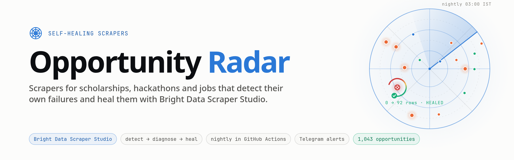
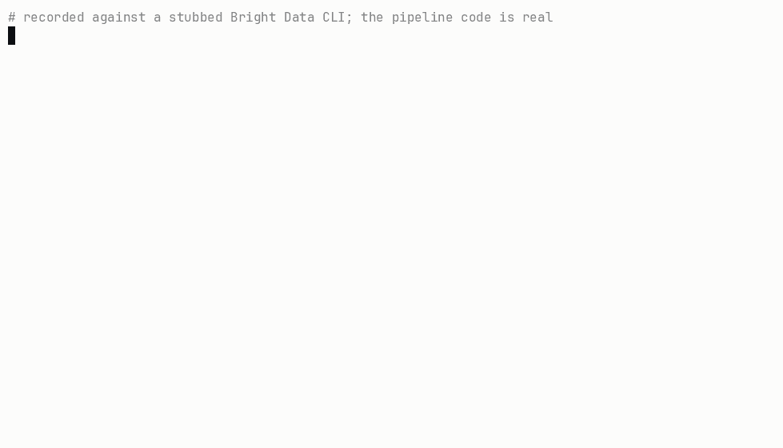
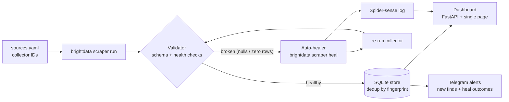
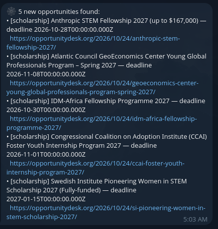
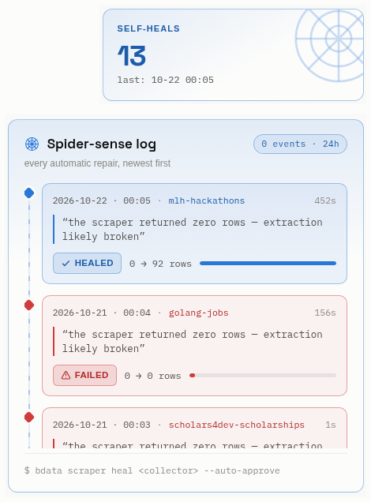
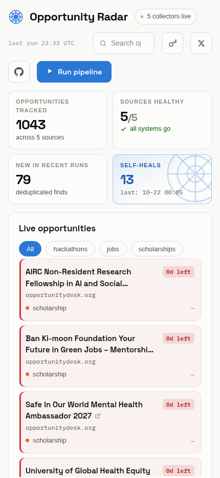

<p align="center">
  
</p>

<p align="center">
  <a href="https://github.com/yashksaini-coder/opportunity-radar/actions/workflows/ci.yml"></a>
  <a href="https://github.com/yashksaini-coder/opportunity-radar/actions/workflows/scrape.yml"></a>
  
  <a href="LICENSE"></a>
  <a href="https://github.com/sponsors/yashksaini-coder"></a>
</p>

<p align="center">
  <b>Scrapers for scholarships, hackathons and jobs that notice when a run comes back empty or malformed, write a one-line diagnosis, and hand it to <code>brightdata scraper heal</code> to repair the collector.</b><br>
  Running unattended every night in GitHub Actions since 2026-08-21 (the committed run history starts 2026-08-22). Built solo for the WeMakeDevs × Bright Data "Into the Scrape-Verse" hackathon (Aug 17–23, 2026).
</p>

<p align="center">
  <a href="#how-it-works">How it works</a> ·
  <a href="#quick-start">Quick start</a> ·
  <a href="#telegram-alerts">Telegram</a> ·
  <a href="#dashboard">Dashboard</a> ·
  <a href="#sources">Sources</a> ·
  <a href="#deploy">Deploy</a> ·
  <a href="#development">Development</a>
</p>

<p align="center">
  
</p>

> [!NOTE]
> The recording above runs the real pipeline, validator, healer, SQLite store and notifier, but the Bright Data CLI is **stubbed** (`subprocess.run` inside `radar/brightdata.py` is replaced, nothing touches the network): the first `scraper run` returns zero rows (standing in for a broken site), the heal returns ok, the second run replays `raw_output/mlh_run.json`, a saved real CLI output with 24 events. The pauses are artificial. The real production heal on 2026-10-22 went 0 → 92 rows and took 452 s. Regenerate it with `uv run python scripts/record_heal_demo.py`.

## Live

**Dashboard: https://opportunity-radar-v64k.onrender.com/** (Render free tier, Docker; the first request after idle can take ~30 s).

As of the 2026-10-24 23:29 UTC nightly run (the committed `data/seed.db` snapshot):

- **1,043 opportunities** tracked: 856 scholarships, 133 hackathons, 54 jobs, from 5 sources.
- **325 recorded runs**: 313 ok, 6 healed, 6 failed. **13 heal attempts** in the Spider-sense log: 7 healed, 6 failed (one more heal than healed runs because the first heal, python-jobs on 2026-08-22 11:12 UTC, predates the oldest surviving run record).
- Latest heal: 2026-10-22 00:05 UTC, `mlh-hackathons`, "the scraper returned zero rows — extraction likely broken", **HEALED, 0 → 92 rows in 452 s**, no human involved.

These numbers change every night. The banner's "1,043 opportunities" chip was baked in on 2026-10-25.

## The problem

Scholarships, fellowships, hackathons and job boards live on small sites that students rarely have time to check. Aggregators built on top of them tend to die the same way: **the site changes, the scraper breaks, and nobody notices until the data is stale.**

Opportunity Radar does not add a human to babysit the scrapers. Each run is judged against a schema and health thresholds; when a run fails, the pipeline writes a one-line diagnosis, hands it to Scraper Studio's heal command, re-runs the repaired collector, re-validates, and logs the whole intervention. When the heal works the nightly job goes green on its own; when it does not, the run exits 1 and the failure is logged. As of 2026-10-25, 7 of 13 heal attempts have worked.

## How it works


<details>
<summary>The same loop as a mermaid diagram</summary>



</details>

One pass per source, in `radar/pipeline.py`:

1. **Scrape.** Each source in `config/sources.yaml` is one Scraper Studio collector, created once from a natural-language description with `brightdata scraper create` and executed with `brightdata scraper run <id> <url> --json` (600 s timeout; the CLI handles the realtime → batch fallback). Rows pass through pydantic: only `http(s)` URLs survive, titles are length-capped, and the dedup fingerprint is `sha1(lower(source|title|url))`.
2. **Validate.** `radar/validator.py` turns silent failures into diagnoses: zero rows → "the scraper returned zero rows — extraction likely broken"; fewer than `min_rows` (3) → "only N rows returned (expected at least 3)"; a required field (`title`, `url`) null in more than 40% of rows → "required field 'title' is missing or null in 8/10 rows (80%)"; pydantic failures → "N rows failed schema validation (…)".
3. **Heal.** `radar/healer.py` builds the prompt "The scraper output failed validation: *diagnosis*. The site layout may have changed. Expected output: *source.description*. Please repair the extraction so all expected fields are populated." (capped at 1000 characters, because the heal API rejects longer prompts), then runs `brightdata scraper heal <id> "<prompt>" --url <url> --timeout 1800 --auto-approve`, re-runs, re-validates, and stores a `HealingEvent` (outcome, rows before and after, duration). A failed heal never raises; it is recorded, the pipeline moves on, and the process exits 1 at the end.
4. **Deliver.** `radar/store.py` records the heal and upserts healthy rows into SQLite (`opportunities`, `runs`, `healing_events`); `radar/alerts.py` posts every heal and any new finds to Telegram, and the dashboard reads the same database.

## Quick start

```bash
git clone https://github.com/yashksaini-coder/opportunity-radar && cd opportunity-radar
make install                              # uv venv + requirements.txt (falls back to python3 -m venv)
npx -p @brightdata/cli brightdata login   # or put BRIGHTDATA_API_KEY in .env
cp .env.example .env                      # Telegram pair and RADAR_RUN_TOKEN are optional
make run                                  # python -m radar.pipeline, all 5 sources
make dashboard                            # http://localhost:8000
```

`make run-one SOURCE=mlh-hackathons` runs a single source. The committed collector ids in `config/sources.yaml` belong to the author's Bright Data account; to run against your own, create one collector per source (one-time) and paste the returned `c_…` id into the file:

```bash
npx -p @brightdata/cli brightdata scraper create \
  "https://www.mlh.com/seasons/2027/events" \
  "Extract hackathon events: title, url, start_date, end_date, location, whether in-person or digital."
# → prints the collector id (c_…)   → collector_id in config/sources.yaml
```

<details>
<summary>Requirements</summary>

- Python 3.11+ (CI runs 3.12). Dependencies: pydantic, PyYAML, requests, fastapi, uvicorn, pytest.
- Node 18+ (20 in CI; the Docker image installs Debian's packaged nodejs), only for the Bright Data CLI via `npx -p @brightdata/cli`. The wrapper also picks up a global `brightdata` or `bdata` binary.
- A Bright Data account: `brightdata login`, or `BRIGHTDATA_API_KEY` in `.env` for headless runs.
- `uv` is optional; `make install` uses it when present.

</details>

## Watch it heal itself

```bash
make demo-heal SOURCE=mlh-hackathons
# = python -m radar.pipeline --source mlh-hackathons --simulate-breakage mlh-hackathons
```

`--simulate-breakage` strips `title`, `url` and `link` from the scraped rows in memory, so the validator fails and the real heal → re-run → re-validate path fires against the real collector. This spends Bright Data credits and takes minutes (the production heal on 2026-10-22 took 452 s).

Or wait for a real break: when a scheduled run comes back empty or broken, that same run attempts a heal with no flag; the Spider-sense log records whether it worked (7 of 13 attempts have, as of 2026-10-25). The validator cannot tell a layout change from a transient empty response: 12 of the 13 diagnoses so far were zero or too-few rows, 4 of the 7 successful heals were golang-jobs (a 3–4 row page at the `min_rows` threshold), and scholars4dev recovered on 2026-10-22 with 335 rows after four failed heals in a row, without any repair landing. Set `RADAR_AUTO_APPROVE=0` to keep a human gate in the loop; the heal then waits for `brightdata scraper approve`.

## It heals itself in CI too

`.github/workflows/scrape.yml` (`nightly-scrape`) runs the whole pipeline every night, scheduled for 21:30 UTC (03:00 IST), and on `workflow_dispatch`. GitHub Actions cron is best-effort and in practice the run usually starts between 21:45 and 02:00 UTC (once as late as 05:31), most often around 23:30, which is why the timestamps in this README land near midnight UTC. It copies the committed `data/seed.db` to `data/radar.db`, runs `python -m radar.pipeline`, writes a job summary with `scripts/ci_summary.py` (per-source status, row counts, healing events), commits the refreshed `data/seed.db` back as `chore: refresh seed` so the Render dashboard shows last night's finds on its next cold start, and uploads `radar.db` as an artifact for 14 days.

Record so far, from `data/seed.db` on 2026-10-25: **325 recorded source runs since 2026-08-22 (almost all from the nightly job), 313 ok, 6 healed, 6 failed; 13 heal attempts, 7 healed, 6 failed.** The workflow exits 1 when a heal did not fix a source. Of the 65 scheduled runs since 2026-08-21, 5 exited 1 that way: Sep 2, Oct 17, Oct 18 and twice on Oct 20 UTC (the Oct 19 night's run started late, at 00:28; the Oct 20 night's run had two failed heals, scholars4dev-scholarships and golang-jobs). Oct 22–24 were green. 65 of the repository's 107 commits are the bot's seed refreshes.

To run it in your fork: add `BRIGHTDATA_API_KEY` (and optionally `TELEGRAM_BOT_TOKEN` and `TELEGRAM_CHAT_ID`) under Actions secrets, then trigger `nightly-scrape` once from the Actions tab.

## Telegram alerts

The pipeline posts to Telegram through `radar/alerts.py`. The hosted instance posts to the author's private chat (the one `TELEGRAM_CHAT_ID` in its secrets); the bot is **[@opportunity_radara_bot](https://t.me/opportunity_radara_bot)** (yes, "radara"). To receive alerts yourself, run your own instance (below).

<table>
  <tr>
    <td align="center"></td>
    <td align="center"></td>
  </tr>
  <tr>
    <td align="center">the hosted bot, <a href="https://t.me/opportunity_radara_bot">t.me/opportunity_radara_bot</a>; it posts only to the author's chat, so scanning shows you the bot but does not subscribe you (see below)</td>
    <td align="center">what a nightly alert looks like</td>
  </tr>
</table>

Two message kinds, in the format the code produces (one item shown):

```
🕸️ 5 new opportunities found:
• [scholarship] Anthropic STEM Fellowship 2027 (up to $167,000) — deadline 2026-10-28T00:00:00.000Z
  https://opportunitydesk.org/2026/10/24/anthropic-stem-fellowship-2027/
```

A message lists at most 8 items; with more, it ends with `…and N more on the dashboard.`

```
🕷️ Spider-sense: source 'mlh-hackathons' broke.
Diagnosis: the scraper returned zero rows — extraction likely broken
✅ Outcome: healed (0→92 rows, 452s)
```

**What the bot does and does not do.** The code only sends to the one `TELEGRAM_CHAT_ID` in its environment. There is no `/start` handler and no subscriber list, so opening the hosted bot and pressing Start does not subscribe you to anything. Like any Telegram bot it can be added to a group from its profile ("Add to Group or Channel"), but it will only post there if an instance is configured with that group's chat id.

**Run your own.** This is the real way to get the alerts:

1. Message [@BotFather](https://t.me/BotFather), `/newbot`, copy the token.
2. Open your new bot in Telegram and press Start (a bot cannot message a user who has never started it; such a send fails with 403 and is only logged as a warning). Then get a chat id: your own user id from [@userinfobot](https://t.me/userinfobot), or add your bot to a group or channel and use that chat's id (group ids are negative).
3. Put both in `.env` (see `.env.example`):
   ```
   TELEGRAM_BOT_TOKEN=123456:ABC…
   TELEGRAM_CHAT_ID=123456789
   ```
4. `make run`. Without the pair the notifier logs `[telegram disabled] …` instead of sending, and the pipeline runs normally. A failed send is logged as a warning and never stops a run.

In GitHub Actions the same two values go in as repository secrets.

## Dashboard


`dashboard/app.py` is a FastAPI app serving `dashboard/static/index.html`, one page with no build step. Filters (all / hackathons / jobs / scholarships), search, deadline countdown chips, paging, per-source health with the last five run outcomes, and the Spider-sense timeline. It reads the same SQLite file the pipeline writes.

<table>
  <tr>
    <td> --auto-approve"></td>
    <td></td>
  </tr>
</table>

| Endpoint | What it does |
|---|---|
| `GET /` | the single-page dashboard |
| `GET /api/opportunities?category=&limit=` | deduplicated opportunities; `category` is an enum, `limit` ≤ 500 (default 200) |
| `GET /api/health` | per-source status from the last 100 runs |
| `GET /api/healing-log?limit=` | Spider-sense events, newest first, `limit` ≤ 100 |
| `GET /api/config` | whether `POST /api/run` needs a token |
| `POST /api/run` | starts a pipeline run in the background: single-flight, 60 s cooldown, 3/min per IP, `X-Run-Token` header required when `RADAR_RUN_TOKEN` is set |
| `GET /api/run` | status of the current or last run |
| `POST /api/sources` `{"url": …}` | validates the URL like `sources.yaml` and appends it to `config/sources.extra.yaml` as `queued`; the response tells you the `brightdata scraper create` command to finish the job. Same token rule as `/api/run` |

The "Run pipeline" button on the public site needs the run token; without it, visitors can browse but not spend scraping credits.

## Sources

Five collectors, all server-rendered, low-protection listing pages that Bright Data's pre-built scraper library does not cover. Public data only: no logins, paywalls, personal data or government sites. Counts are from `data/seed.db` on 2026-10-25.

| id | site | category | tracked |
|---|---|---|---:|
| `opportunitydesk` | [Opportunity Desk](https://www.opportunitydesk.org/) — scholarships & fellowships | scholarship | 569 |
| `scholars4dev-scholarships` | [Scholars4Dev](https://www.scholars4dev.com/) — international scholarships | scholarship | 287 |
| `mlh-hackathons` | [MLH 2027 season events](https://www.mlh.com/seasons/2027/events) | hackathon | 133 |
| `python-jobs` | [Python.org job board](https://www.python.org/jobs/) | job | 50 |
| `golang-jobs` | [GolangProjects](https://www.golangprojects.com/) — Go developer jobs | job | 4 |

Health thresholds, shared by all sources: `min_rows: 3`, `max_null_ratio: 0.4`, `required_fields: [title, url]`.

**Adding a source** is one YAML entry plus one CLI call:

```bash
npx -p @brightdata/cli brightdata scraper create "https://example.org/listings" \
  "Extract listings: title, url, deadline, host organization, award or benefits."
```

```yaml
# config/sources.yaml
  - id: example-listings
    name: Example — Listings
    url: https://example.org/listings
    collector_id: "c_xxxxxxxxxxxx"     # from scraper create
    category: scholarship              # hackathon | scholarship | job
    description: >                     # reused by the healer as the expected output
      Extract listings: title, url, deadline, host organization, award or benefits.
```

The `description` matters: it is what the healer sends Scraper Studio as the expected output when the collector breaks. Config is validated at load: duplicate or malformed ids, non-`http(s)` URLs, malformed collector ids and government/military domains fail fast. `POST /api/sources` on the dashboard does the YAML half for you and prints the `scraper create` command to run.

## Project structure

```
radar/
  config.py            # sources.yaml (+ sources.extra.yaml) + .env → typed Settings; validation
  models.py            # Opportunity, ValidationReport, HealingEvent, RunRecord (pydantic)
  brightdata.py        # CLI wrapper: scraper run / heal, output flattening
  validator.py         # health checks → diagnosis → capped heal prompt
  healer.py            # heal → re-run → re-validate → HealingEvent
  store.py             # SQLite: opportunities (deduped), runs, healing_events
  alerts.py            # Telegram Notifier (logs instead of sending when unset)
  pipeline.py          # python -m radar.pipeline [--source ID] [--simulate-breakage ID]
dashboard/
  app.py               # FastAPI: 7 endpoints + static page
  security.py          # per-IP sliding-window rate limit, security headers
  static/index.html    # the dashboard, no build step
config/sources.yaml    # the 5 sources + health thresholds
data/
  seed.db              # nightly snapshot committed by CI; seeds the deploy on cold start
  example_output.json  # sample rows from a real run
raw_output/            # saved real CLI outputs (mlh_run.json feeds the demo GIF; tests carry their own trimmed copies)
scripts/
  ci_summary.py        # GitHub Actions job summary (statuses, rows, heals)
  start.sh             # container entrypoint: seed radar.db, then uvicorn --proxy-headers
  record_heal_demo.py  # regenerates docs/img/heal-demo.gif (stubbed CLI, real pipeline)
  export_example.py    # writes data/example_output.json
docs/
  img/                 # banner, heal-loop, dashboard shots, Telegram QR + alert, demo GIF
  src/                 # HTML sources for banner.png, social-preview.png, heal-loop.png
tests/                 # 41 pytest tests, CLI faked
.github/workflows/
  ci.yml               # tests on push / PR
  scrape.yml           # nightly-scrape: pipeline + self-heal + seed commit
Dockerfile             # Python 3.12 + Node + @brightdata/cli, runs scripts/start.sh
```

## Deploy

The `Dockerfile` runs the dashboard and the pipeline in one image (Python 3.12 slim plus the Bright Data CLI). On Render, Railway or Fly:

1. New web service → connect this repo → Docker runtime.
2. Environment variables: `BRIGHTDATA_API_KEY` (required; the CLI authenticates headlessly with it), `RADAR_RUN_TOKEN` (recommended on any public URL: visitors can browse, but only requests carrying it in `X-Run-Token` can trigger runs or add sources), and optionally `TELEGRAM_BOT_TOKEN` and `TELEGRAM_CHAT_ID`.
3. `scripts/start.sh` copies `data/seed.db` to `data/radar.db` on a cold start (free tiers have no persistent disk), so the page has data on the first request without spending credits. If the store is still empty it runs one pipeline pass in the background. Then it starts uvicorn with `--proxy-headers` so the rate limiter sees real client IPs.

Trigger a run remotely:

```bash
curl -X POST https://<your-app>/api/run -H "X-Run-Token: <token>"
```

Because the nightly workflow commits the refreshed `data/seed.db`, a redeploy of the live site picks up last night's data even though the container itself keeps nothing.

## How Scraper Studio is used

Scraper Studio is the extraction layer and the repair mechanism. Collectors are created from natural language (`scraper create`), driven from code (`scraper run <id> <url> --json`), and repaired by AI with diagnoses this pipeline writes for it (`scraper heal <id> "<prompt>" --url <url> --timeout 1800 --auto-approve`). Every call goes through `radar/brightdata.py`, which shells out to the CLI with argument lists and flattens the output shapes seen in real runs: flat rows, rows nested under a list key like `events`, wrapper elements with only an `input` echo and empty lists, and per-input error records (the last two are dropped rather than counted as rows). No pre-built Bright Data scrapers are used; every collector is custom, aimed at sites whose layouts change, which is what the heal path is for.

## Hardening

The app assumes both its inputs and its clients can be hostile:

- **Scraped data is untrusted.** Every row passes schema validation; only `http(s)` URLs survive (no `javascript:` or `data:` links can reach the dashboard), titles are length-capped, and the frontend escapes all text it renders.
- **Config is validated at load.** `sources.yaml` fails fast on duplicate or malformed ids, non-`http(s)` URLs, malformed collector ids, and government/military domains (disallowed by the hackathon rules). `POST /api/sources` applies the same checks.
- **The API is rate-limited per client IP** in `dashboard/security.py` (sliding window: 120/min on read endpoints, 3/min for `POST /api/run`) with `429 + Retry-After`; query params are typed and bounded (`category` enum, `limit ≤ 500`).
- **`POST /api/run` spends scraping credits**, so it is single-flight with a 60 s cooldown and token-gated via `RADAR_RUN_TOKEN` on public deployments.
- **Security headers** (CSP, nosniff, frame-deny, no-referrer) ship on every response; API errors never leak internals; secrets stay in `.env` (gitignored); CLI calls use argument lists, never a shell.

Behind a reverse proxy, run uvicorn with `--proxy-headers` (`scripts/start.sh` does).

## Development

| Target | What it runs |
|---|---|
| `make install` | `uv venv` + `uv pip install -r requirements.txt`, or `python3 -m venv .venv` without uv |
| `make run` | `python -m radar.pipeline` |
| `make run-one SOURCE=<id>` | `python -m radar.pipeline --source <id>` |
| `make demo-heal SOURCE=<id>` | `python -m radar.pipeline --source <id> --simulate-breakage <id>` |
| `make dashboard` | `uvicorn dashboard.app:app --reload` on :8000 |
| `make test` | `pytest -q`; 41 tests (validator 9, security 12, real output shapes 8, add source 6, healer 3, store 3), the CLI is faked |

<details>
<summary>Regenerating the README art</summary>

The HTML sources under `docs/src/` use local fonts via `file://` (Noto Sans in `/usr/share/fonts/noto`, JetBrainsMono Nerd Font in `/usr/share/fonts/TTF`); on another machine they fall back to system fonts. The banner's "1,043 opportunities" chip and the figure's "0 → 92 rows" row are hard-coded from the 2026-10-25 snapshot. `social-preview.png` is not referenced here; upload it by hand under repo Settings → Social preview.

```bash
# banner.png (2x) and social-preview.png (1x, 2:1)
chromium --headless=new --no-sandbox --disable-gpu --hide-scrollbars --force-device-scale-factor=2 --window-size=1280,400 --screenshot=docs/img/banner.png file://$PWD/docs/src/banner.html
chromium --headless=new --no-sandbox --disable-gpu --hide-scrollbars --force-device-scale-factor=1 --window-size=1280,640 --screenshot=docs/img/social-preview.png file://$PWD/docs/src/banner-social.html
magick docs/img/banner.png -strip -define png:compression-level=9 -define png:compression-filter=5 docs/img/banner.png
magick docs/img/social-preview.png -strip -define png:compression-level=9 docs/img/social-preview.png

# heal-loop.png (2x)
chromium --headless=new --no-sandbox --disable-gpu --hide-scrollbars --force-device-scale-factor=2 --window-size=1280,560 --screenshot=docs/img/heal-loop.png file://$PWD/docs/src/heal-loop.html
magick docs/img/heal-loop.png -strip docs/img/heal-loop.png

# heal-demo.gif (needs `agg` on PATH; stubbed CLI, real pipeline)
make install && uv run python scripts/record_heal_demo.py

# dashboard.png, spider-sense.png, dashboard-mobile.png (live site; crop offsets depend on the current layout)
chromium --headless=new --no-sandbox --disable-gpu --hide-scrollbars --force-device-scale-factor=1 --window-size=1440,1000 --virtual-time-budget=8000 --screenshot=docs/img/dashboard.png https://opportunity-radar-v64k.onrender.com/
chromium --headless=new --no-sandbox --disable-gpu --hide-scrollbars --force-device-scale-factor=1 --window-size=1440,1400 --virtual-time-budget=8000 --screenshot=/tmp/tall.png https://opportunity-radar-v64k.onrender.com/
chromium --headless=new --no-sandbox --disable-gpu --hide-scrollbars --force-device-scale-factor=1 --window-size=430,932 --virtual-time-budget=8000 --screenshot=/tmp/mobile.png https://opportunity-radar-v64k.onrender.com/
magick /tmp/tall.png -crop 338x126+1069+77 +repage /tmp/tile.png
magick /tmp/tall.png -crop 458x486+949+656 +repage /tmp/panel.png
magick -background '#fcfcfb' /tmp/tile.png \( -size 458x12 xc:'#fcfcfb' \) /tmp/panel.png -gravity East -append -bordercolor '#fcfcfb' -border 6 -strip -define png:compression-level=9 docs/img/spider-sense.png
magick docs/img/dashboard.png -strip -define png:compression-level=9 docs/img/dashboard.png
magick /tmp/mobile.png -strip -define png:compression-level=9 docs/img/dashboard-mobile.png
```

</details>

## AI usage disclosure

AI tools were used in this project, as permitted by the hackathon rules: Scraper Studio's AI generates and heals the collectors (that is the sponsor platform itself), and an AI coding assistant (Claude) helped scaffold and refine code, docs and the README art. Architecture, integration, site selection, testing and debugging are my own.

## License

MIT — see [LICENSE](LICENSE).
